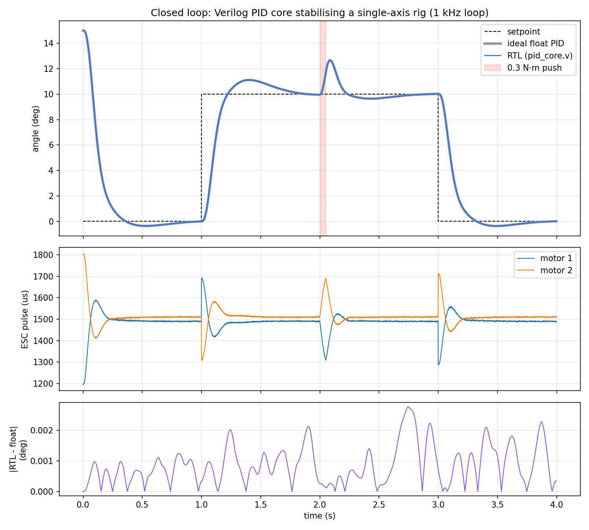
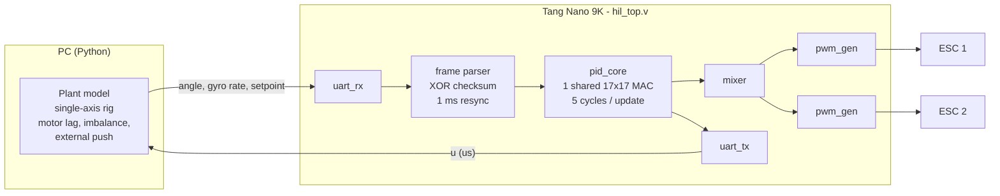

# FPGA Flight-Control Core

A fixed-point attitude PID controller written in Verilog, verified bit-exactly against a Python golden model, closed-loop tested against a rigid-body plant model, and built for a Tang Nano 9K (Gowin GW1NR-9) with a hardware-in-the-loop interface.

It's a first step toward a flight controller whose control path runs in our own hardware instead of on an off-the-shelf MCU.



## What's here



| File | Purpose |
|---|---|
| `rtl/pid_core.v` | PID with a single time-shared multiplier, D-on-gyro (no derivative kick), integrator clamp (anti-windup), round-and-saturate output |
| `rtl/mixer.v` | Differential motor mixer with ESC range clamp |
| `rtl/pwm_gen.v` | 400 Hz ESC PWM, glitch-free (width latched per frame) |
| `rtl/uart_rx.v`, `uart_tx.v` | 8N1 UART, 115200 baud |
| `rtl/hil_top.v` | Board top: framed protocol, gain upload, PWM pins, status LEDs |
| `model/fc_model.py` | Single source of parameters; bit-exact golden model; ideal float PID; plant; plots |
| `sim/tb_pid_vectors.v` | 20,000-vector self-checking unit test |
| `sim/tb_closed_loop.v` | RTL in closed loop with the plant (4 s, 1 kHz) |
| `sim/tb_hil_top.v` | End-to-end top-level test over the UART pins |
| `host/hil.py` | Runs the plant on the PC with the FPGA as the controller |

## Design choices

**Fixed-point formats.** Angle Q8.8 deg (0.004° resolution), gyro Q12.4 deg/s (±2000 dps, same as an MPU6050), Kp and Kd in Q8.8, Ki in UQ0.16 with the loop period folded in so the integrator needs no divide. All terms are aligned in a 48-bit Q.24 accumulator, then rounded once at the output.

**One multiplier, not three.** At 27 MHz with a 1 kHz loop, an update has a budget of 27,000 cycles. The core uses 5 cycles, so the P, I and D products share one 17×17 multiplier. That saves two-thirds of the multiplier area for 3 cycles of latency, which matters if this goes toward an ASIC.

**D on measurement.** The derivative uses the gyro rate rather than d(error)/dt, so setpoint steps don't kick the motors, and the core never has to differentiate a noisy angle signal.

**Anti-windup.** The integrator is clamped to ±20 µs, twice the imbalance it has to cancel. With the final gains, lowering the clamp from 100 µs to 20 µs cut step overshoot from 30.5% to 11.1% (found by a gain sweep).

**Same arithmetic in the model and the RTL.** The plant in the testbench uses the same double-precision operation order as the Python model, so whole closed-loop runs can be compared bit for bit, not just within a tolerance.

## Results

```
make all       # unit test, closed loop, reference check, top-level UART test
```

| Check | Result |
|---|---|
| Unit test, 20,000 random and edge-case vectors (full-range inputs, random gains, resets) | **bit-exact** vs golden model |
| Closed loop, 4,000 updates with sensor noise | **bit-exact** vs golden model |
| Fixed-point RTL vs ideal float PID | max 0.0028° difference |
| Top level over UART: 300 frames, gain upload, PWM width, corrupted frame | **all pass** |

Step response, 0 → 10°:

| | Rise (10–90%) | Overshoot | 2% settling | Steady-state error |
|---|---|---|---|---|
| RTL | 130 ms | 11.1% | 753 ms | 0.04° |
| Ideal float PID | 130 ms | 11.1% | 754 ms | 0.04° |

The 0.3 N·m push at t = 2 s is rejected with 2.7° of peak deviation.

### Tang Nano 9K (GW1NR-LV9, open-source Yosys + nextpnr + apicula flow)

| Build | LUT4 | ALU | DFF | DSP | Fmax (target 27 MHz) |
|---|---|---|---|---|---|
| Multiplier in DSP | 1114 (12%) | 522 | 634 (9%) | 1 MULT18X18 | 68.1 MHz |
| Multiplier in LUTs (`-nodsp`, used for the bitstream) | 3189 (36%) | 560 | 634 (9%) | 0 | 32.7 MHz |

The DSP build places and routes, but the current apicula packer can't encode DSP input registers yet, so the shipped bitstream uses `-nodsp`. Comparing the two builds shows the area/timing cost of a soft multiplier: about 2,000 extra LUTs and half the Fmax.

## Running it

Needs [oss-cad-suite](https://github.com/YosysHQ/oss-cad-suite-build) and Python 3 with numpy and matplotlib.

```
make all                  # simulate and verify everything
make synth                # bitstream -> build/hil.fs
make flash                # program the Tang Nano 9K
pip install pyserial
python3 host/hil.py       # hardware-in-the-loop run -> results/hil_fpga.png
```

Board pins: PWM on 25/26, UART on the on-board USB bridge, S2 is reset. LEDs: heartbeat, frame activity, checksum error, output saturated, and the sign of the correction.

## Next steps

- [ ] Real IMU: SPI driver for an ICM-42688 or MPU6050 and a fixed-point complementary or Mahony filter in RTL
- [ ] Three axes with a quad-X mixer, plus a cascaded angle → rate loop like production flight controllers
- [ ] DShot600 output instead of analog PWM
- [ ] Physical two-motor test rig
- [ ] Formal properties (SymbiYosys) for output bounds and FSM liveness
- [ ] Get the DSP mapping through the open flow, or build with Gowin EDA for comparison
